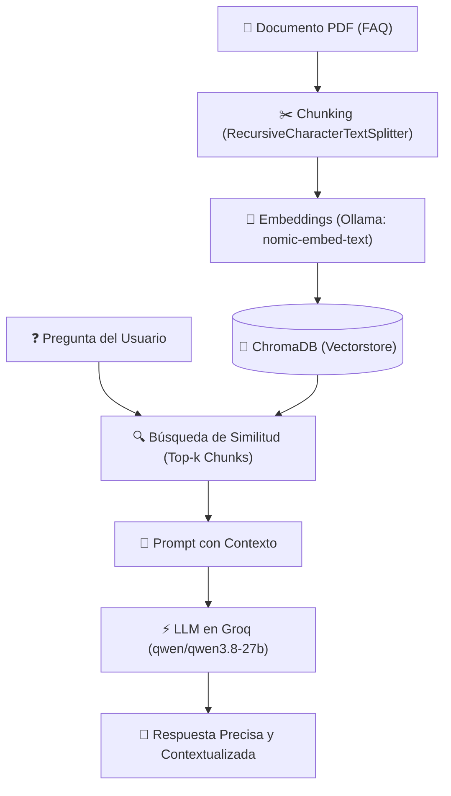

# 🔍 RAG Mínimo - Preguntas Frecuentes (FAQ)

Implementación práctica y funcional de un pipeline **RAG (Retrieval-Augmented Generation)** utilizando **LangChain**, embeddings locales con **Ollama**, persistencia vectorial con **ChromaDB** y generación de respuestas de alto rendimiento mediante **Groq**.

El sistema permite consultar e indexar documentos PDF locales (en este caso `Preguntas_frecuentes__FAQ_.pdf`), recuperando los fragmentos más relevantes para responder preguntas sin alucinaciones y ciñéndose estrictamente a la fuente.

---

## 🏗️ Arquitectura del Pipeline RAG



---

## 📁 Estructura del Módulo

- **[`rag_minimo.py`](rag_minimo.py)**: Código completo del pipeline RAG:
  1. Extracción y lectura del PDF (`pypdf`).
  2. División en fragmentos de texto (~800 caracteres con solapamiento).
  3. Generación y almacenamiento de embeddings vectoriales en `./chroma_db`.
  4. Invocación de `ChatGroq` con recuperación de contexto dinámico.
- **`Preguntas_frecuentes__FAQ_.pdf`**: Documento base indexado para el caso de uso.
- **`requirements.txt`**: Librerías necesarias (`langchain`, `langchain-groq`, `langchain-chroma`, `langchain-ollama`, `pypdf`, etc.).
- **`.env`**: Clave de API de Groq (no versionado).

---

## 🛠️ Requisitos Previos

1. **Python**: 3.10 o superior.
2. **Ollama**:
   - Descarga el modelo de embeddings:
     ```bash
     ollama pull nomic-embed-text
     ```
3. **Groq API Key**:
   - Consigue tu API key gratuita en [console.groq.com](https://console.groq.com).

---

## 📦 Instalación

1. Clona el repositorio e ingresa al directorio:
   ```bash
   git clone https://github.com/Mariogarluu/RAG-1.git
   cd RAG-1
   ```

2. Crea y activa tu entorno virtual:
   ```bash
   python -m venv .venv
   # Windows:
   .venv\Scripts\activate
   # Linux/macOS:
   source .venv/bin/activate
   ```

3. Instala los paquetes requeridos:
   ```bash
   pip install -r requirements.txt
   ```

4. Crea el archivo `.env` en la raíz del proyecto:
   ```env
   GROQ_API_KEY=tu_clave_de_groq_aqui
   ```

---

## 🚀 Uso

Ejecuta el script para indexar y probar la consulta:
```bash
python rag_minimo.py
```
